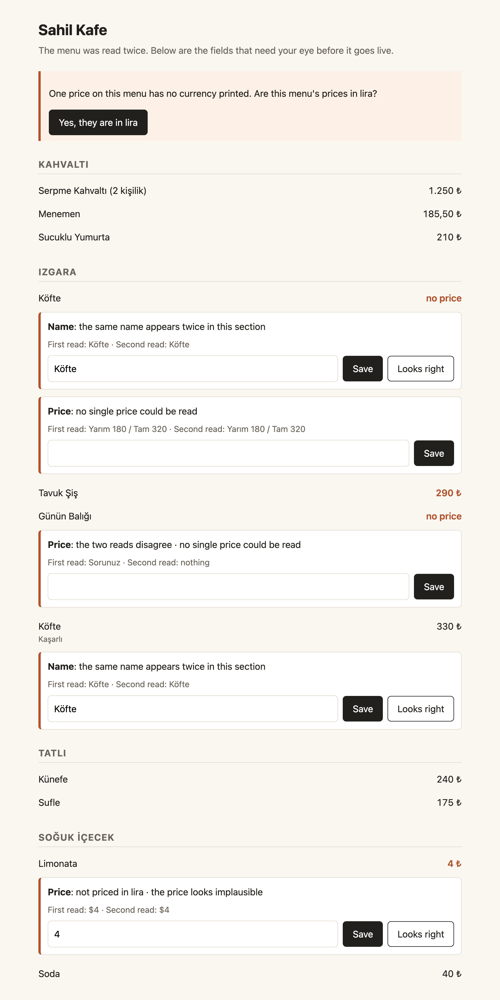
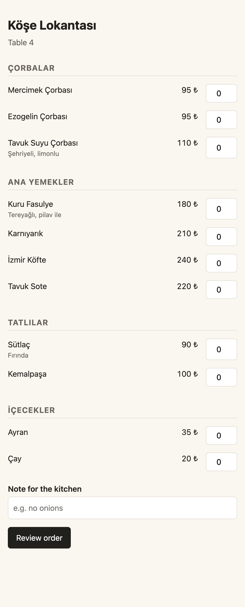
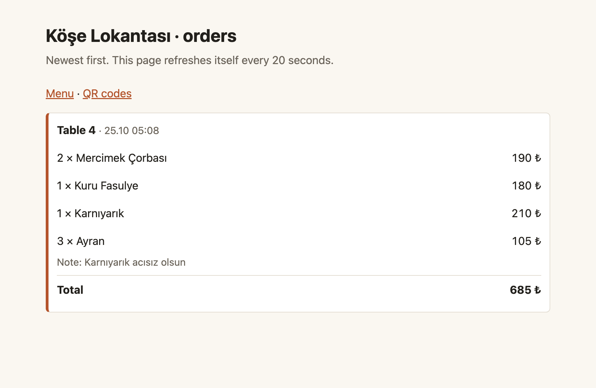

# menu-to-order

[](https://github.com/Saudade01/menu-to-order/actions/workflows/ci.yml)

Turn a photo of a paper menu into a working QR order page.

A restaurant owner photographs the printed menu, the service reads it, and a
couple of minutes later the owner has an ordering page without typing anything in.

Reading the menu is the easy part. Most of this codebase deals with the cases
where the model reads it wrong.

## Why model mistakes matter here

Vision models misread menus. `180 ₺` comes back as `18 ₺`, a section header
turns into a dish, and two items with the same name get merged into one. A wrong
price on a live menu costs money on every order until someone notices it.

So the system follows one rule: nothing reaches a live page unless it has been
verified or confirmed by a human.

## How verification works

Each extracted field gets a confidence score built from three independent
signals:

1. Cross-pass agreement. The menu is extracted twice with different prompts.
   Where the passes disagree, the field is marked and both candidate values are
   kept.
2. Rule checks. A price has to parse, fall inside a plausible range, and carry a
   currency. Item names have to be unique within a category, and categories have
   to come from the set detected on the menu.
3. Model self-report. The model marks fields it read from blurred, cropped, or
   low-contrast parts of the photo.

Fields that pass all three are published. The rest go to a review queue where
the owner confirms or corrects them. Every correction is logged, so first-pass
accuracy is something the system measures over time.

## Results on the sample menus

The three sample menus are rendered by `samples/render.py`, so the right answer
for every field is known. Scored against the recorded Gemini responses, before
the owner has touched anything:

| Menu | Dishes | Fields | Read right | Right but flagged | Ambiguous, flagged | Misread, flagged | Reached the page unflagged |
|---|---|---|---|---|---|---|---|
| Köşe Lokantası (clean print) | 11 | 44 | 44 | 0 | 0 | 0 | 0 |
| Sahil Kafe (awkward prices) | 11 | 44 | 38 | 3 | 3 | 0 | 0 |
| Mangal Evi (glare and blur) | 10 | 40 | 37 | 3 | 0 | 0 | 0 |
| All | 32 | 128 | 119 | 6 | 3 | 0 | 0 |

Gemini read every unambiguous field correctly here, which is why the misread
column is empty. These are clean renders, and real phone photos will be harder;
misreads such as `180 ₺` coming back as `18 ₺` are covered by tests built from
constructed cases instead. The three prices the menus themselves leave open (a
half and full portion, "Sorunuz", a dollar price) were all flagged. Six correct
fields went to the owner anyway: two dishes sharing a name, a price printed
without a currency, and three prices the model marked as hard to read.

`AccuracyTests` fails CI if a wrong or ambiguous field ever gets through
unflagged. The generated table lives in `docs/accuracy.md`.

## What it looks like

| Owner review | Table menu on a phone | Incoming orders |
|---|---|---|
|  |  |  |

## Stack

| Layer | Choice |
|---|---|
| API | ASP.NET Core Minimal API (.NET 10) |
| Data | PostgreSQL + Entity Framework Core |
| Vision / extraction | Gemini Flash |
| Order page | Server-rendered Razor components |
| Local dev | Docker Compose (Postgres) |

## Run it locally

You need the .NET 10 SDK and Docker.

```bash
docker compose up -d
dotnet run --project src/Api
```

Without an API key the app replays Gemini responses recorded from real calls, so
the three photos in `samples/menus` work straight away. To read your own photos,
create a free key in Google AI Studio and store it with user-secrets:

```bash
dotnet user-secrets set "Gemini:ApiKey" "<your key>" --project src/Api
```

`dotnet test` runs the whole suite, including the database tests, which start
their own Postgres container.

## Status

The whole path works locally: upload, review, publishing, per-table QR codes, and
ordering from the table page with the total worked out on the server from the
published prices. The design is in `docs/architecture.md`.

## Why it exists

To get a small restaurant's menu online without anyone retyping it, and without
a wrong price slipping through.

Plenty of cafés and lokantas have a printed menu and nothing else. Putting it
online usually means entering every dish and price by hand, and a typo in a
price costs money on every order until someone spots it. Here the owner takes
one photo, answers the few questions the system is unsure about, and prints a
QR code for each table. Guests order from their phones, the owner sees each
order with its table and note, and nothing goes live that the owner has not had
the chance to check.
